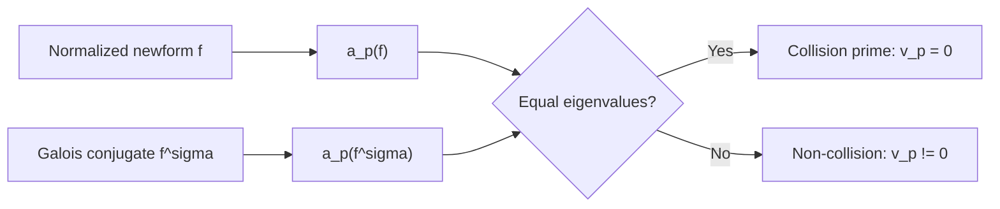
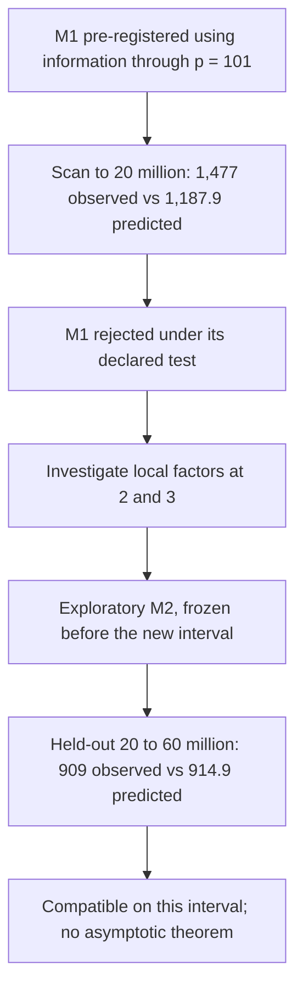

# J₀(23) — Hecke Eigenvalue Collisions


<sub>Visual study · geometric illustration, not measured Hecke eigenvalues or a collision-count plot.</sub>

**Congruence constraints · residual trace distributions · Lang–Trotter-type density heuristics**

For the Galois-conjugate normalized weight-2 newforms $f,f^\sigma$ on $\Gamma_0(23)$, a **collision prime** is a prime $p$ satisfying $a_p(f)=a_p(f^\sigma)$. We study the congruence constraints at these primes and the observed frequency of collisions.

Two lines of inquiry remain distinct: arithmetic congruences proved from stated inputs, and a density experiment in which a pre-registered model failed before its exploratory successor was evaluated on a held-out prime range.

**RESEARCH NOTE / R14b** · 23 November 2026

| Scan | Collision primes | Model check |
|---|---:|---|
| 3,562,113 primes, $3 \le p \le 6\times10^7$, $p\ne23$ | **2,386** | M2 held-out: **909 observed / 914.9 predicted** |

[Paper (PDF)](paper/collision_primes_J0_23.pdf) · [LaTeX source](paper/collision_primes_J0_23.tex) · [Mathematical dossier](docs/R14b_dossier.md) · [Claim and evidence ledger](results/R14b_Collision_Prime_Audit.json) · [M1 pre-registration](results/R14b_PREREG_M1.md) · [M2 pre-registration](results/R14b_PREREG_M2.md)

> **Evidence rule:** exact identities, conditional deductions, finite checks, and heuristic models carry distinct proof obligations.

## Definition and coefficient identities

Let $f,f^\sigma\in S_2(\Gamma_0(23))$ be the conjugate eigenforms with Hecke field $K=\mathbb Q(\sqrt5)$. Set $\phi^2=\phi+1$ and write

$$
a_p(f)=u_p+v_p\phi,\qquad u_p,v_p\in\mathbb Z.
$$

For a prime $p\ne2,23$:

$$
\boxed{p\text{ is a collision prime}\iff a_p(f)=a_p(f^\sigma)\iff v_p=0.}
$$

The first eight are **13, 19, 29, 43, 109, 223, 229, 271**.

### Collision criterion



The criterion is an algebraic equivalence in the Hecke field, not a statement about geometric intersections of curves.

The coefficient identities used in the scan are

$$
v_p=[q^p]\,\eta(z)^2\eta(23z)^2,
\qquad
u_p=[q^p]\,\theta_{2,1,3}(z)\eta(z)\eta(23z),
$$

where $\theta_{2,1,3}(z)=\sum_{x,y\in\mathbb Z}q^{2x^2+xy+3y^2}$ and $q=e^{2\pi iz}$.

**Precision boundary:** these are exact identities, while the large coefficient scan uses floating-point FFT convolution followed by integer rounding. The repository records checks against PARI `mfcoefs` through $n=10^4$, independent PARI point counts at 468 primes (zero mismatches), and FFT rounding residuals below $5\times10^{-8}$ in the recorded run. Those checks support the *reported finite computation*; they are not a general proof of floating-point correctness at arbitrary bounds.

## Congruence results and open claims

| Result | Statement | Evidence status |
|---|---|---|
| **Theorem A: rigidity mod 22** | At a collision, $a_p\equiv p+1\pmod{11}$, and $a_p$ is odd iff $p=2x^2+xy+3y^2$ for integers $x,y$. Thus $a_p\bmod22$ is fixed by $p$. | Proof in the dossier **conditional on cited standard inputs** (Mazur's Eisenstein ideal, the endomorphism ring, and Eichler–Shimura); 0 recorded exceptions among 2,386 collisions |
| **L1: parity** | $v_p$ is even for every $p\ne2,23$. | Two proofs recorded; full-range scan agrees |
| **R1: principal-form mod 4** | If $p=x^2+xy+6y^2$, then $T_p\equiv1+p\pmod{4\mathcal O}$, $\mathcal O=\mathbb Z[\phi]$. | Proof recorded using Eichler–Shimura; 593,491 cases checked |
| **R2: nonprincipal-form mod 4** | If $p=2x^2+xy+3y^2$, then $v_p\equiv p-1\pmod4$. | **Conjecture**, not proved; 1,187,172 cases checked, 0 exceptions |
| **Mod-3 trace frequencies** | The recorded frequencies agree with an explicitly constructed binary-icosahedral group model $\langle i\rangle\cdot2.A_5\subset GL_2(\mathbb F_9)$ of order 240. | Measured frequency match. The projective image $A_5$ is **source-reported** (Billerey–Dieulefait, arXiv:1210.5428 §5.3, attributing to Ribet and Kiming–Verrill), consistent with an independent check (Frobenius cycle types of $X^5+3X^3+6X^2+9$ agree with mod-3 traces at all 17,981 primes $\le2\cdot10^5$, 0 mismatches); the full 3-adic image is a model hypothesis |

A particularly sharp consequence of Theorem A is

$$
a_p(f)=0\ \Longrightarrow\ p\equiv10\pmod{11}.
$$

The recorded scan finds **43, 109, and 1033** as the only such primes within its range.

**Proof is not novelty.** Theorem A uses established inputs and may be folklore. R2 remains open despite its large numerical test. The [dossier](docs/R14b_dossier.md) separates proofs, imported facts, finite checks, model-derived factors, and unresolved claims.

## Density models: rejection and held-out evaluation

The Lang–Trotter-style *heuristic* here is that collision probability scales like $p^{-1/2}$, with local corrections:

$$
\Pr(v_p=0)\ \approx\ \frac{8\sqrt5}{3\pi^2}\,\widehat F\,p^{-1/2}.
$$

- **M1** used a generic local factor at 3 and a full-preimage assumption at 2. It was pre-registered before the scan beyond $p\le101$. By $2\times10^7$ it predicted **1,187.9** collisions; the scan found **1,477** ($z\approx+8.4$). **M1 was refuted.**
- **M2** replaced the factor at 3 with the icosahedral model and used an **empirical** factor at 2 from local divisibility frequencies, *not collision counts*. This revision was post hoc relative to M1, but frozen **before** testing the interval $(2\times10^7,6\times10^7]$.

| Held-out interval | Observed | M2 predicted | Standardized residual |
|---|---:|---:|---:|
| $(2\times10^7,4\times10^7]$ | 504 | 524.6 | −0.90 |
| $(4\times10^7,6\times10^7]$ | 405 | 390.3 | +0.75 |
| **Combined** | **909** | **914.9** | **−0.19** |

This is **one successful held-out check**, not proof of the density heuristic or of an asymptotic law. M2 also over-predicts noticeably at smaller bounds, so finite-$p$ corrections remain an active problem.

### Model evaluation, in order



A comparison with Van Hirtum's level-23 constant is consistent with the finite-range effect of approximating $\sum_{p\le x}p^{-1/2}$ by $2\sqrt x/\log x$. This approximation effect was already recognized in prior work; our specific numerical comparison remains **inferred**, not a new resolution, and the original fitting procedure has not been fully reconstructed.

## Reproduce and inspect

From the repository root, with Python 3 and NumPy:

```bash
python3 -m venv .venv
source .venv/bin/activate
python -m pip install numpy

# Regression suite. The optional PARI test skips without cypari2.
python -m unittest discover -s tests -p 'test_collision_primes_r14b.py' -v

# Recompute a bounded scan, law audit and M1/M2 predictions.
python -m experiments.collision_primes_r14b 2000000

# Inspect the frozen model declarations.
sha256sum results/R14b_PREREG_M*.md
```

The repository's `requirements.txt` also lists SciPy, SymPy, and `cypari2`. The latter may require a working PARI/GP installation; it is **not required** for the main NumPy scan, and its cross-check test skips when unavailable. The historical 60-million-prime run and its audit are already recorded in `data/` and `results/`; the short command above **does not reproduce** that full scan.

The stored pre-registration file hashes reported in the audit are:

```text
M1  f3d823ab48929614090d8d97f3d8a8aca03b1614b503619eb9196192dc43ed49
M2  c71a78e4594e252d00630b3195d28a3e9ffd54ab90363b525ea6ca1517862f12
```

---

## Repository map

| Path | Role |
|---|---|
| [`docs/R14b_dossier.md`](docs/R14b_dossier.md) | Mathematical argument, assumptions, claims, references, open questions |
| [`paper/`](paper/) | Paper: single-file amsart LaTeX source (compiles warning-free with `latexmk -pdf`, no external files) and compiled PDF |
| [`experiments/collision_primes_r14b.py`](experiments/collision_primes_r14b.py) | Coefficients, arithmetic audits, local image models, density constants |
| [`tests/test_collision_primes_r14b.py`](tests/test_collision_primes_r14b.py) | 10 regression tests; PARI cross-check optional |
| [`results/`](results/) | Pre-registrations, local-factor tests, held-out scores and claim ledger |
| [`data/ap_lean_60000000.npz`](data/ap_lean_60000000.npz) | Saved $(p,u_p,v_p)$ array for the large scan |
| [`scripts/`](scripts/) | Historical scripts retained for provenance, not a polished standalone pipeline |

The historical scripts assume intermediate files in their working directory; see the [dossier](docs/R14b_dossier.md) and script headers before re-running them. **No CI is configured** in this repository.

---

## Open edges

1. **Prove or disprove R2.** Identify the relevant 2-adic Galois image rather than extrapolating from finite congruence checks.
2. **Explain the small-prime bias.** Test a finite-$p$ lattice correction against the existing dataset without recycling the same interval as independent validation.
3. **Reconstruct the literature comparison.** Repeat Van Hirtum's fitting procedure on matched ranges and normalizations.
4. **The 3-adic image.** The mod-3 projective image $A_5$ passed an independent cycle-type check; it remains open whether the 3-adic image is the full preimage of the model group.
5. **Formalize the finite algebraic bridges.** Lean candidates include the mod-11 ideal intersection and the mod-2 trace lemma; **no Lean proof is claimed**.

**Scope:** this repository does *not* prove infinitely many collision primes, establish a new asymptotic theorem, claim novelty, or present a verified Lean formalization.

---

**Lineage:** [Bolyai Research Atlas](https://github.com/Dojo-1/Bolyai-Research-Atlas) · R14 → R14b.

*Exact statements. Reproducible tests. Open questions remain open.*